## Profile

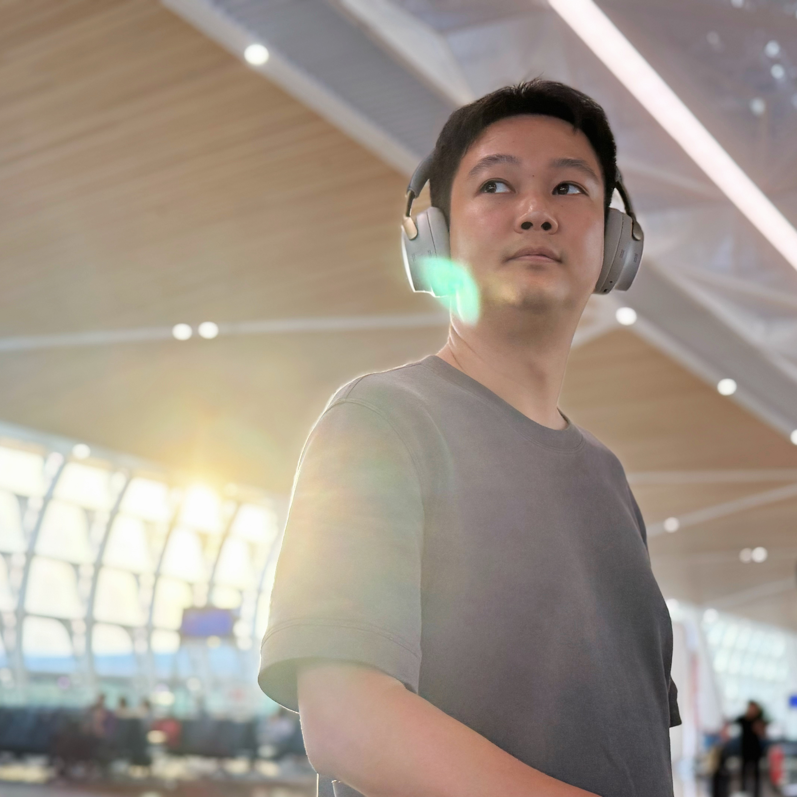
name: Neil
subname: Dr. Zhijing SHAO
tagline: We can only observe the high dimensional world from our low dimensional projection.
links: [GitHub](https://github.com/initialneil) [Google Scholar](https://scholar.google.com/citations?user=UUrJKSkAAAAJ&hl=en&oi=ao) [DBLP](https://dblp.org/pid/359/4184.html)
links: [Kandao](https://www.kandaovr.com/) [Prometheus Vision](https://www.prometh.xyz/)

## About

PhD in CMA, HKUST(GZ), supervised by [Prof. Kang ZHANG](https://facultyprofiles.hkust-gz.edu.cn/thrust-faculties?code=10011A10000000000H2A) and [Prof. Zeyu WANG](https://facultyprofiles.hkust-gz.edu.cn/faculty-personal-page/WANG-Zeyu/zeyuwang).
Senior Researcher, Collov Labs.

## Short Bio

- I received my BSc degree from Dalian University of Technology, China in 2012, my MSc degree from Hong Kong University of Science and Technology (HKUST) in 2013, and my PhD degree from HKUST(GZ) in 2026.
- From 2016 to 2018, I was in the founding team of [Kandao](https://www.kandaovr.com) as Head of Algorithm. I started and led the vision team in charge of computer vision related algorithms and desktop software.
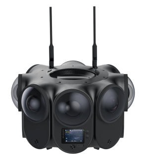 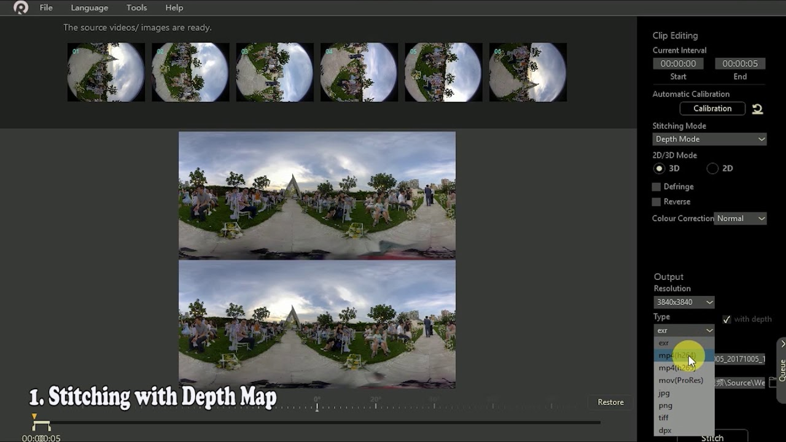 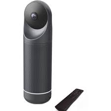

- In 2018, I cofounded Zhuhai [Prometheus Vision](https://www.prometh.xyz) as CTO. We make the best Volumetric Video solution in China.
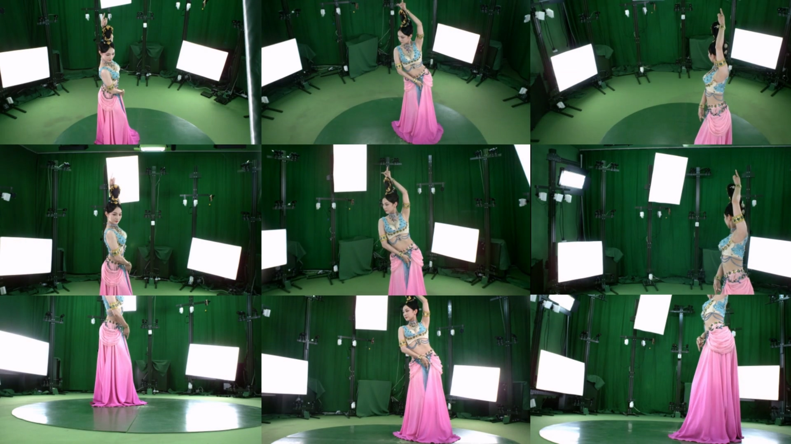 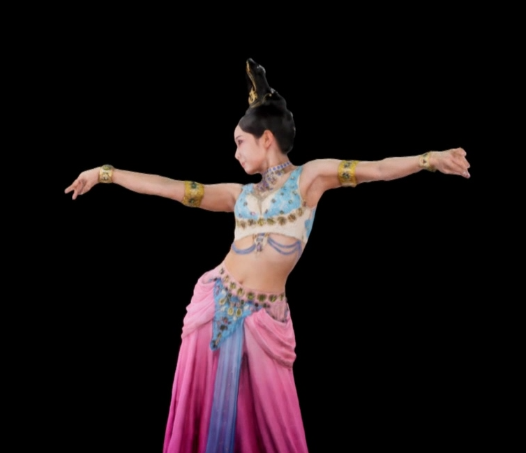 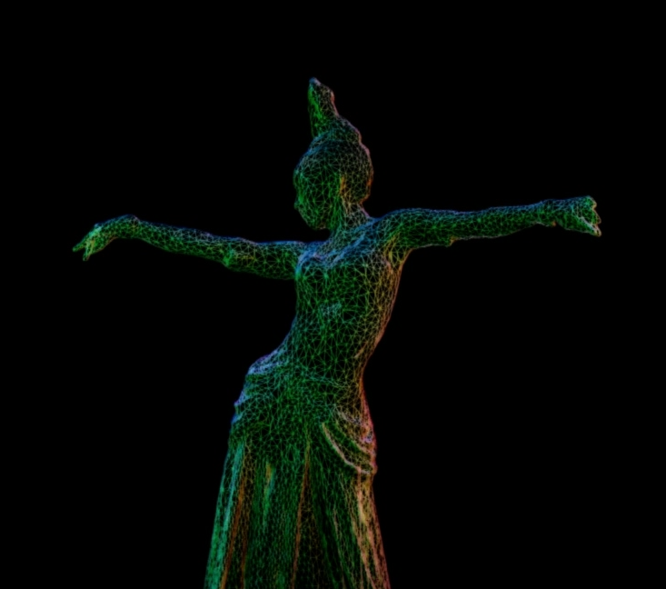

- In 2022, I was appointed off-campus supervisor of Tsinghua Shenzhen International Graduate School.

- I regularly serve as a reviewer for TPAMI, TVCG, CVPR, ICCV, ECCV, 3DV, NeuIPS, SIGGRAPH, AAAI, etc.

## Popular Repos

### SplattingAvatar
[CVPR 2024] Official implementation: realistic real-time human avatars with mesh-embedded Gaussian splatting.
[code](https://github.com/initialneil/SplattingAvatar) [project](SplattingAvatar.html)
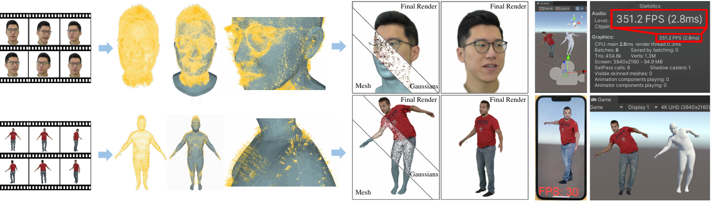

### DEGAS
[3DV 2025] Official implementation: detailed expressions on full-body Gaussian avatars.
[code](https://github.com/initialneil/DEGAS) [project](DEGAS.html)
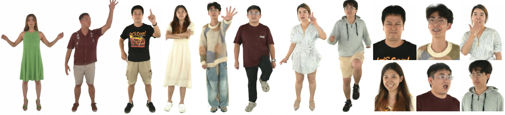

### project-with-reflect
Claude Code meta-skill: turn each project, machine or device into a self-improving skill (log → reflect → improve).
[code](https://github.com/initialneil/project-with-reflect)
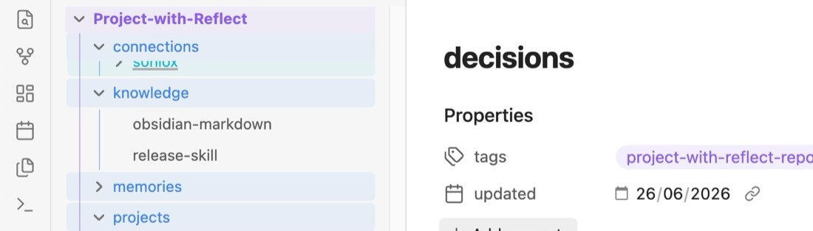

### TEDWB1k & TEDWB10k & TEDUB10k
Whole-body and upper-body human avatar datasets built from TED talks, with SMPL-X and FLAME tracking. Browse the public preview repos below; the full tracked datasets are access-gated.
[TEDWB1k](https://huggingface.co/datasets/initialneil/TEDWB1k-preview) [TEDWB10k](https://huggingface.co/datasets/initialneil/TEDWB10k-preview) [TEDUB10k](https://huggingface.co/datasets/initialneil/TEDUB10k-preview)
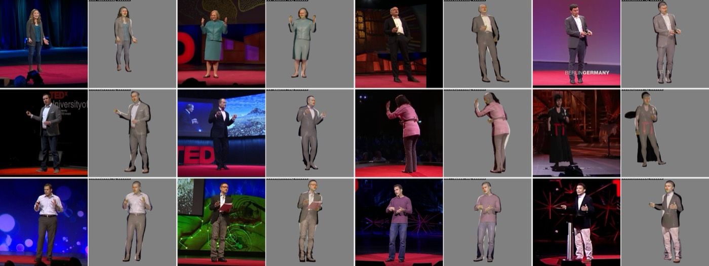

## Publications

Full publication list: [DBLP](https://dblp.org/pid/359/4184.html) [Scholar](https://scholar.google.com/citations?user=UUrJKSkAAAAJ&hl=en&oi=ao)

### [ECCV 2026] OmniFit: Multi-modal 3D Body Fitting via Scale-agnostic Dense Landmark Prediction
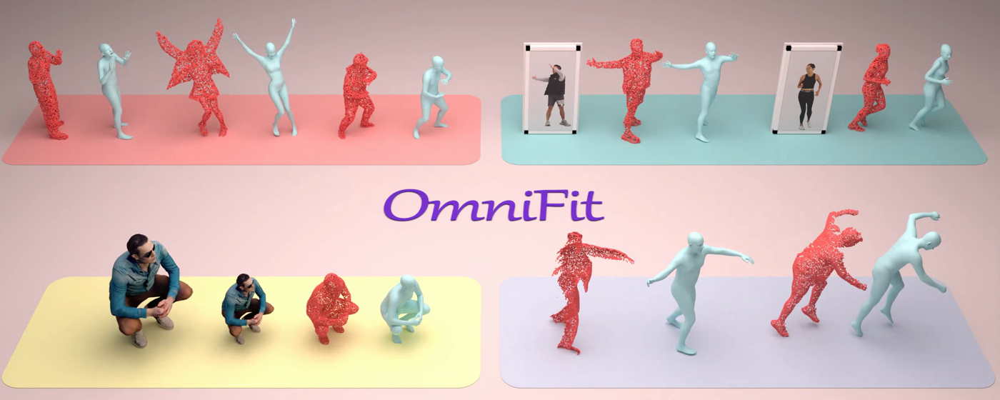
[project](https://zcai0612.github.io/OmniFit/) [arxiv](https://arxiv.org/abs/2604.21575) [code](https://github.com/zcai0612/OmniFit)
Zeyu Cai, Yuliang Xiu, Renke Wang, **Zhijing Shao**, Xiaoben Li, Siyuan Yu, Chao Xu, Yang Liu, Baigui Sun, Jian Yang, Zhenyu Zhang

### [SIGGRAPH 2026] InvSculpt: Inverse Sculpting Modeling via Controlled 3D Generation and a Vector Displacement Field
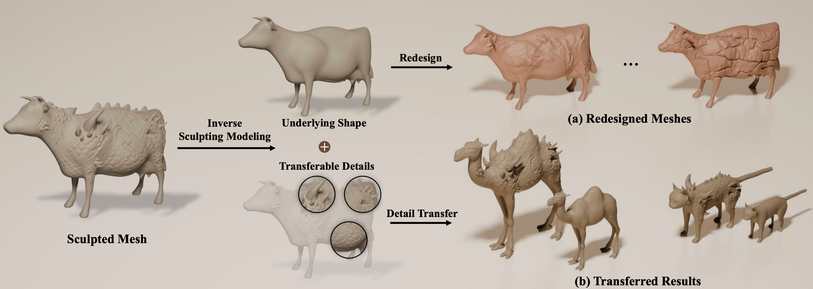
Hengyu Meng, Lanjiong Li, **Zhijing Shao**, Yingda Yin, Lingting Zhu, Zeyu Hu, Xin Wang, Ligang Liu, Zeyu Wang

### [ICCV2025] Text2VDM: Text to Vector Displacement Maps for Expressive and Interactive 3D Sculpting
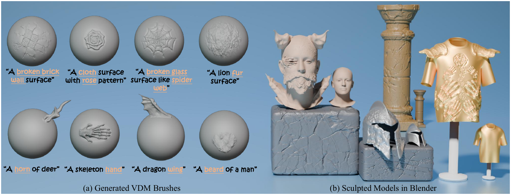
[arxiv](https://arxiv.org/abs/2502.20045)
Hengyu Meng, Duotun Wang, **Zhijing Shao**, Ligang Liu, Zeyu Wang

### [SIGGRAPH Asia 2025 Poster] HybridDeform4D: Joint Refinement of Mesh and Gaussian Splatting for Video-to-4D Object Generation
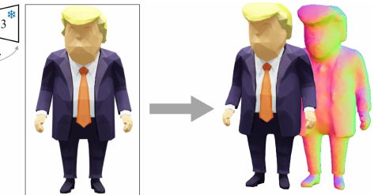
[paper](https://dl.acm.org/doi/10.1145/3757374.3771441)
Duotun Wang, Yuhang Li, **Zhijing Shao**, Wanjun Lv, Liuxin Zhang, Mingming Fan, Zeyu Wang

### [3DV2025] DEGAS: Detailed Expressions on Full-Body Gaussian Avatars

[project](DEGAS.html) [arxiv](http://arxiv.org/abs/2408.10588) [code](https://github.com/initialneil/DEGAS)
**Zhijing Shao**, Duotun Wang, Qing-Yao Tian, Yao-Dong Yang, Hengyu Meng, Zeyu Cai, Bo Dong, Yu Zhang, Kang Zhang, Zeyu Wang

### [3DV2025] HeadEvolver: Text to Head Avatars via Expressive and Attribute-Preserving Mesh Deformation
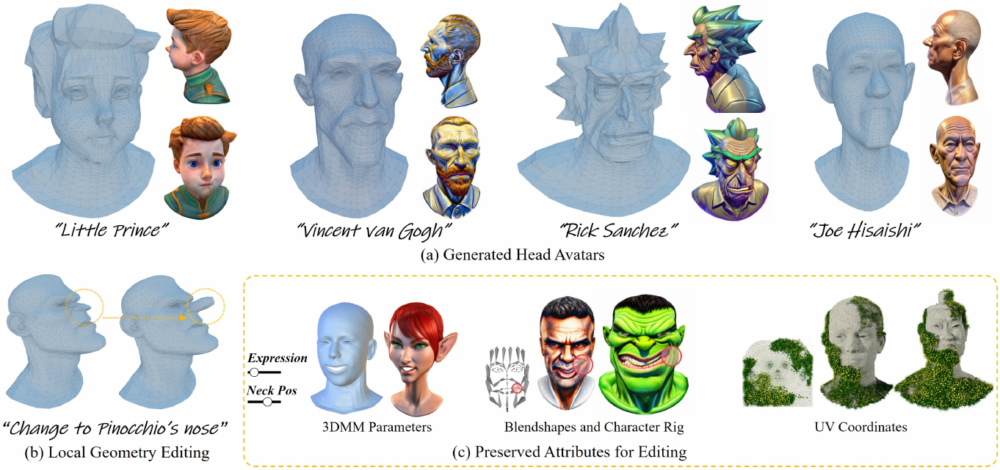
[project](https://www.duotun-wang.co.uk/HeadEvolver/)
Duotun Wang, Hengyu Meng, Zeyu Cai, **Zhijing Shao**, Qianxi Liu, Lin Wang, Mingming Fan, Xiaohang Zhan, Zeyu Wang

### [CVPR2024] SplattingAvatar: Realistic Real-Time Human Avatars with Mesh-Embedded Gaussian Splatting

[project](SplattingAvatar.html) [arxiv](https://arxiv.org/abs/2403.05087) [code](https://github.com/initialneil/SplattingAvatar)
**Zhijing Shao**, Zhaolong Wang, Zhuang Li, Duotun Wang, Xiangru Lin, Yu Zhang, Mingming Fan, Zeyu Wang

### [PG2024] DreamMapping: High-Fidelity Text-to-3D Generation via Variational Distribution Mapping
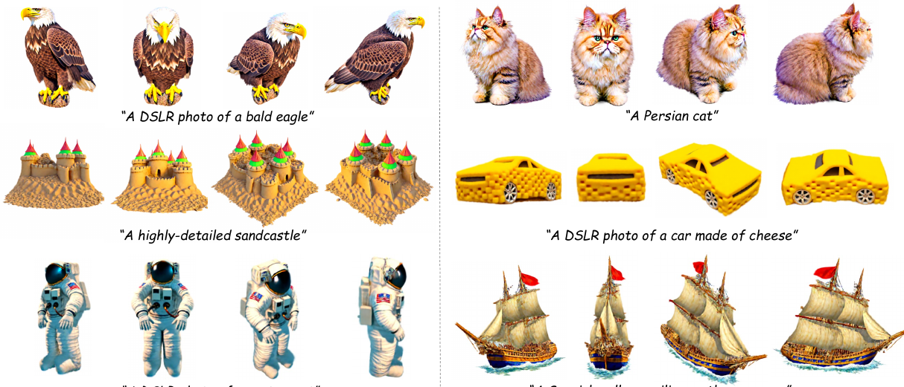
Zeyu Cai, Duotun Wang, Yixun Liang, **Zhijing Shao**, Ying-Cong Chen, Xiaohang Zhan, Zeyu Wang

### [ICME2024] SMPLX-Lite: A Realistic and Drivable Avatar Benchmark with Rich Geometry and Texture Annotations
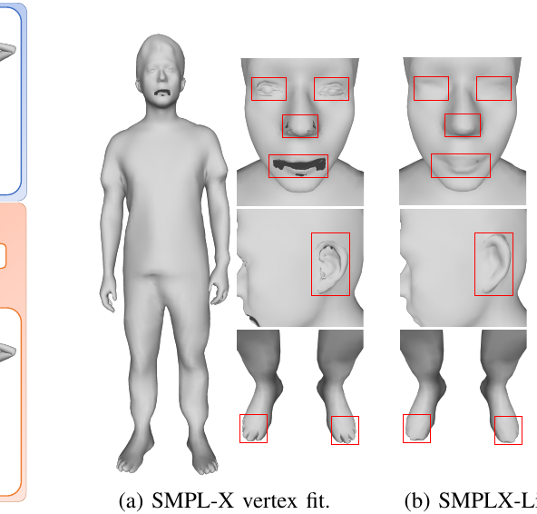
Yujiao Jiang, Qingmin Liao, Zhaolong Wang, Xiangru Lin, Zongqing Lu, Yuxi Zhao, Hanqing We, Jinrui Ye, Yu Zhang, **Zhijing Shao**

### [MM '23] Patchmatch Stereo++: Patchmatch Binocular Stereo with Continuous Disparity Optimization
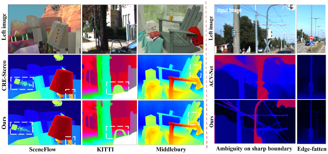
[paper](https://dl.acm.org/doi/10.1145/3581783.3611862)
Wenjia Ren*, Qingmin Liao, **Zhijing Shao***, Xiangru Lin*, Xin Yue, Yu Zhang, Zongqing Lu (*equal contribution)

### [IEEE Trans. Learn. Technol. 16(6): 1154-1164 (2023)] Introducing Massive Open Metaverse Course and Its Enabling Technology
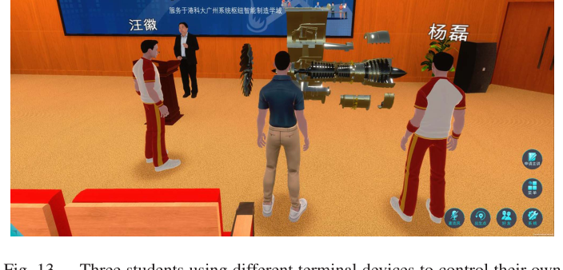
[paper](https://ieeexplore.ieee.org/document/10164142)
Kang Zhang, **Zhijing Shao**, Yun Lu, Ying Yu, Wei Sun, Zeyu Wang
